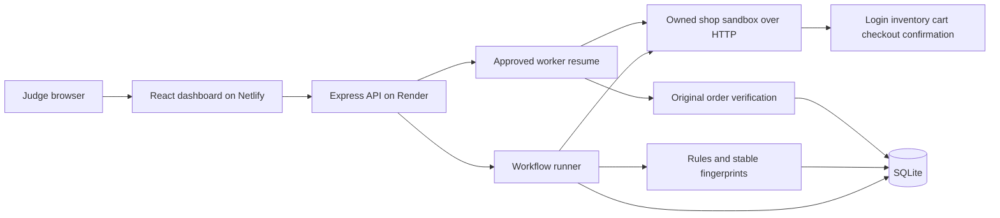

# BizPlus AI architecture

The React frontend sends a browser demo-session ID to an Express API. The API executes a fixed synthetic customer journey through its owned sandbox over HTTP. SQLite stores runs, evidence, incidents, and recovery records. Shared TypeScript contracts keep the client and API aligned.

## Failure and recovery data flow

The missing-confirmation scenario pauses a worker for one transaction. Checkout records one synthetic payment, while the confirmation response reports a missing order with HTTP 200. The assertion failure creates an incident containing the actual response and worker evidence.

Recovery requires approval of the supported `resume_receipt_worker` action. It resumes that transaction’s worker and verifies the original order. It never repeats checkout. Unique payment keys and confirmation records make repeated approvals idempotent. The incident resolves only after verification passes.

## Hosting boundaries

Netlify serves the built frontend and Render runs the backend. The frontend exposes only its API base URL. Exact CORS origins restrict browser access; they do not replace authentication. The browser session ID separates demo records but is not an authenticated identity.

SQLite history is temporary on the free hosted filesystem. The schema recreates on startup and the readiness response identifies the running instance. The local fallback uses a local database and requires no network after dependencies are installed.
