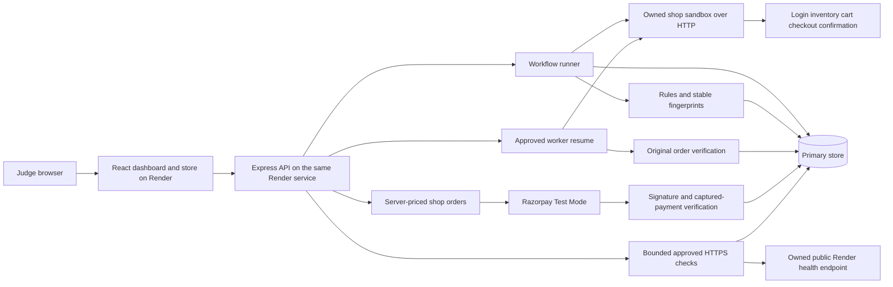

# BizPlus AI architecture

The React frontend and Express API share one public Render origin. A browser demo-session ID separates monitoring, live-check, and storefront records. The API executes a fixed synthetic journey through its owned sandbox, runs bounded checks against approved public HTTPS targets, and integrates Razorpay Test Mode checkout. Shared TypeScript contracts keep the client and API aligned.

## Failure and recovery data flow

The missing-confirmation scenario pauses a worker for one transaction. Checkout records one synthetic payment, while the confirmation response reports a missing order with HTTP 200. The assertion failure creates an incident containing the actual response and worker evidence.

Recovery requires approval of the supported `resume_receipt_worker` action. It resumes that transaction’s worker and verifies the original order. It never repeats checkout. Unique payment keys and confirmation records make repeated approvals idempotent. The incident resolves only after verification passes.

## Hosting boundaries

Render builds and serves both applications. The frontend exposes its API origin and Razorpay public test key ID; payment secrets and database credentials stay on the server. Exact CORS origins restrict browser access; they do not replace authentication. The browser session ID separates demo records but is not an authenticated identity.

The current hosted primary store is SQLite with temporary history. The schema recreates on startup and the readiness response identifies the running instance. Setting a valid PostgreSQL `DATABASE_URL` selects the private PostgreSQL schema as the primary store. That adapter and repeatable migration were tested against local PostgreSQL; the selected Supabase cloud connection is still pending. An explicit configured PostgreSQL failure stops startup rather than silently reverting to SQLite.

The local sandbox fallback requires no network after dependencies are installed. Razorpay checkout and public website checks require internet access even when their UI runs locally. Store purchases and live checks are kept separate from synthetic workflow metrics.
